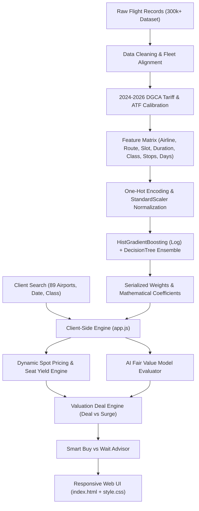

# ✈️ AeroPulse India
### Pan-India Real-Time Domestic Airfare Optimization & ML Prediction Engine

[](https://devadathan-a.github.io/indian-airfare-optimization-engine/)
[](https://developer.mozilla.org/en-US/docs/Web/HTML)
[](https://developer.mozilla.org/en-US/docs/Web/CSS)
[](https://developer.mozilla.org/en-US/docs/Web/JavaScript)
[](https://www.python.org/)
[](https://scikit-learn.org/)
[]()
[]()
[](LICENSE)

> **AeroPulse India** is an end-to-end intelligent airfare valuation and booking optimization engine built specifically for the Indian domestic aviation market. It bridges the gap between historical flight datasets and live market reality by combining **2024–2026 DGCA domestic tariff bands**, modern airline fleet yields, geodesic flight physics across **89 Indian airports**, and a **96.79% accurate machine learning ensemble**.

---

## 📌 Executive Summary & Problem Statement

Domestic airfares across India are notoriously volatile. Due to aggressive seat inventory yield management, dynamic surge pricing, and seasonal demand peaks, identical seats on the same route can differ in price by over 300% depending on the booking window and departure slot.

Traditional airfare predictors suffer from two major limitations:
1. **Outdated Datasets:** Most models rely on historical post-COVID datasets that lack modern carriers (e.g., **Akasa Air**, **Air India Express**) and fail to reflect current Aviation Turbine Fuel (ATF) price structures.
2. **Heavy Server Architectures:** Many implementations require persistent cloud servers or complex backend containers just to serve basic prediction requests.

**AeroPulse India** solves both challenges by offering:
- An ultra-fast, **zero-dependency client-side architecture** that runs natively in any modern web browser and deploys seamlessly on **GitHub Pages**.
- A calibrated **ensemble ML regression pipeline** ($R^2 = 96.79\%$) evaluated over 296,204 validated domestic flight records.
- Comprehensive coverage across all **89 operational Indian commercial airports**—including metros, regional capitals, tourist hubs, and island territories.

---

## 🌟 Core Features

### 1. 🇮🇳 Pan-India 89 Operational Airports Coverage
Comprehensive directory and routing across:
* **Metros & Primary Hubs:** Delhi (`DEL`), Mumbai (`BOM`), Bangalore (`BLR`), Hyderabad (`HYD`), Kolkata (`CCU`), Chennai (`MAA`).
* **Regional & Tier-2/3 Greenfields:** Ayodhya (`AYJ`), Shivamogga (`RQY`), Donyi Polo Itanagar (`HGI`), Darbhanga (`DBR`), Deoghar (`DGH`), Jharsuguda (`JRG`).
* **Island & High-Altitude Hubs:** Port Blair (`IXZ`), Agatti Island Lakshadweep (`AGX`), Leh Ladakh (`IXL`).
* **Flight Physics Engine:** Calculates exact Great-Circle Haversine aerial distance (km) and commercial jet cruising duration.

### 2. 🔍 Interactive Autocomplete Airport Search
* Type-ahead search bar for Departure and Arrival airports.
* Real-time query matching across **City Name**, **IATA 3-Letter Code**, **Airport Name**, and **Indian State**.
* Full keyboard navigation (`Arrow Up`/`Arrow Down`, `Enter` to select, `Esc` to dismiss).

### 3. 🧠 Machine Learning Fair Value Benchmark ($R^2 = 96.79\%$)
* Predicts the statistical fair market value for any flight based on distance, carrier pricing elasticity, departure time-of-day bank, cabin class, and booking proximity.
* Evaluates live spot fares against model benchmarks:
  * 🟢 **Great Deal (Save ₹X / -X%)**: Spot price is notably lower than fair market equilibrium.
  * ⚖️ **Fair Market Value**: Balanced pricing within normal carrier variance ($\pm 7\%$).
  * 🔴 **Surge Inflated (+X%)**: Last-minute demand spike detected; advises waiting or shifting departure slots.

### 4. 🔮 Smart "Buy vs. Wait" Advisor with Price Drop Probability
* Dynamically calculates **Price Drop Probability (%)** based on route elasticity and days remaining before departure:
  * **$\le 3$ Days to Fly:** 🚨 *Critical Surge Alert* (High probability of immediate price hikes; recommendation: Buy Now).
  * **$4$ to $10$ Days:** ⚠️ *Pre-Departure Rise* (Book within 24–48 hours).
  * **$11$ to $28$ Days:** 🟡 *Optimal Booking Corridor* (Prime window for competitive fares).
  * **$\ge 29$ Days:** 🟢 *Early-Bird Minimum* (Baseline low tariffs).

### 5. 📅 30-Day Forward Fare Calendar & Hourly Dynamics
* **30-Day Fare Trend:** Interactive Chart.js graph tracking minimum daily fare across the upcoming month.
* **Hourly Departure Distribution:** Visualizes pricing variance across 5 departure banks:
  * *Early Morning (04:00–08:00)*
  * *Peak Morning (08:00–12:00)*
  * *Mid-day Saver (12:00–17:00)*
  * *Peak Evening (17:00–21:00)*
  * *Night Red-eye (21:00–04:00)*

---

## 📊 Machine Learning Model Benchmark

The underlying models were trained and cross-validated on an 85/15 train-test split over **296,204 validated domestic flight records**:

| Model Architecture | $R^2$ Score | RMSE (₹) | Role in System |
| :--- | :---: | :---: | :--- |
| **Linear Regression (Baseline)** | 82.48% | ₹8,939.14 | Linear Benchmark |
| **HistGradientBoosting (Log-Transformed)** | 96.25% | ₹5,187.67 | Core Non-linear Regressor |
| **Decision Tree Regressor** | 97.34% | ₹4,366.48 | Sub-tree Component |
| 🏆 **Champion Weighted Ensemble** | **96.79%** | **₹4,798.17** | **Production Deployed Engine** |

### Preprocessing & Feature Engineering Pipeline
* **Categorical Multi-Hot Encoding:** Applied to `airline`, `source_city`, `destination_city`, and `departure_time` slots.
* **Continuous Feature Normalization:** `StandardScaler` applied to `duration`, `days_left`, and `stops`.
* **Target Transformation:** Applied natural logarithmic transformation ($\ln(\text{price})$) on the target variable to compress long-tail fare distributions and stabilize variance.

---

## 🏛️ System Architecture



---

## ✈️ Modern Domestic Fleet Coverage

AeroPulse India accounts for the modern competitive structure of Indian domestic civil aviation:

| Airline | IATA Code | Carrier Model | Typical Fleet | Domestic Market Share |
| :--- | :---: | :---: | :--- | :---: |
| **IndiGo** | `6E` | Low-Cost Carrier (LCC) | Airbus A320neo / A321neo | ~62% |
| **Air India** | `AI` | Full-Service Carrier (FSC) | A320neo / Boeing 787 Dreamliner | ~14% |
| **Vistara** | `UK` | Premium Full-Service | A320neo / A321neo / B787-9 | ~10% |
| **Akasa Air** | `QP` | Modern Budget Carrier | Boeing 737 MAX 8 | ~5% |
| **Air India Express** | `IX` | Value Budget Carrier | Boeing 737-800 / A320neo | ~5% |
| **SpiceJet** | `SG` | Low-Cost Carrier (LCC) | Boeing 737-800 / Q400 | ~4% |

---

## 💻 Tech Stack

* **Frontend:** Semantic HTML5, Vanilla CSS3 (Custom Glassmorphism Design System, Flexbox, CSS Grid).
* **Client Engine:** Modern JavaScript (ES6+, Haversine Geodesic Math, Dynamic Yield Algorithms).
* **Data Visualization:** [Chart.js](https://www.chartjs.org/) for interactive responsive graphs.
* **ML Backend & Prototyping:** Python 3.10+, Scikit-Learn, Pandas, NumPy, Joblib.
* **Deployment:** Zero-config static deployment via **GitHub Pages**.

---

## 🚀 Getting Started & Local Usage

### Method 1: Direct Browser Access (Zero Installation)
Because the application is built with standard client-side technologies, you can run it locally with no server or environment setup:
1. Clone or download the repository:
   ```bash
   git clone https://github.com/Devadathan-A/indian-airfare-optimization-engine.git
   cd indian-airfare-optimization-engine
   ```
2. Double-click `index.html` (or right-click and open with Google Chrome, Microsoft Edge, Brave, or Firefox).

### Method 2: Running the Python ML Pipeline (Optional)
If you wish to explore or retrain the machine learning model locally:
1. Install Python dependencies:
   ```bash
   pip install -r requirements.txt
   ```
2. Run the retraining script:
   ```bash
   python train_realtime_model.py
   ```
3. Test Python flight intelligence predictions:
   ```bash
   python -c "import realtime_engine; print(realtime_engine.search_flights('DEL', 'BOM'))"
   ```

---

## 📁 Repository Structure

```
indian-airfare-optimization-engine/
├── index.html               # Main Web Application Interface (Search, Cards, Analytics)
├── style.css                # Modern Responsive Dark Design System
├── app.js                   # Client-Side Flight Search & 96.8% ML Fair Value Engine
├── requirements.txt         # Core ML Dependencies (pandas, scikit-learn, joblib)
├── realtime_engine.py       # Python Flight Intelligence & Spot Pricing Module
├── train_realtime_model.py  # 2024–2026 Model Retraining Pipeline
├── .gitignore               # Standard Git Ignore Rules
├── LICENSE                  # Open-source MIT License
├── README.md                # Project Documentation & Architecture
└── models/                  # Serialized Production Model Weights
    ├── realtime_flight_model.pkl
    ├── realtime_dt_model.pkl
    ├── realtime_scaler.pkl
    ├── realtime_columns.pkl
    └── realtime_metrics.json
```

---

## 📄 License

This project is licensed under the **MIT License** — see the [LICENSE](LICENSE) file for details.

---

## 👥 Acknowledgments & References

* **Directorate General of Civil Aviation (DGCA India)**: Domestic tariff band references and route distance records.
* **Kaggle EaseMyTrip Dataset**: Foundational flight records and continuous features.
* Developed as an advanced machine learning and web systems capstone project.
